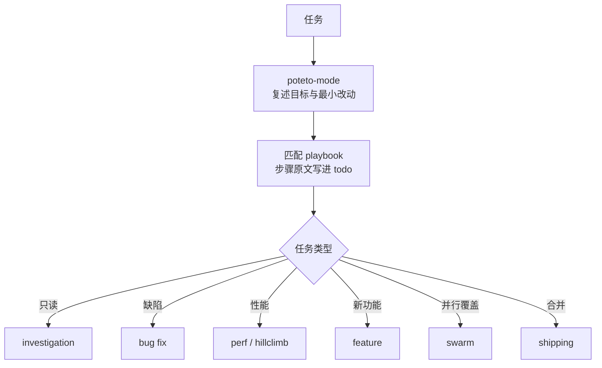

## 定位

pstack 是 Poteto 维护的一套 Agent Skills。它只盯一件事：Agent 把写代码变快以后，代码质量怎么保住。

作者先后在 Meta、Netflix 和 Cursor 工作。他把「AI 写太多 slop」列为主要风险。slop 指看着完整、实际没有价值的代码。README 的原话是 “throughput without quality is not a goal i aspire to”（只有产量没有质量，不是他想追的目标）。他用一句话概括了解法：“if you want to go fast, go deep first”（想走得快，先把深处走通）。

仓库是 `cursor/plugins/pstack` 的独立镜像，用 MIT 许可发布。安装有两种方式：运行 `npx skills add backnotprop/pstack`，或者在 Claude Code 里从 `cursor/plugins` 市场安装。

## 组成

截至 2026-11-03（commit `ecec42ad`），仓库有 58 个 `SKILL.md`、23 个 playbook（预设流程）、24 条原则和 2 个 subagent。这些文件分五层，每层只负责一件事。

| 层            | 内容             | 作用                                                                                                                                                                                          |
| ------------- | ---------------- | --------------------------------------------------------------------------------------------------------------------------------------------------------------------------------------------- |
| `poteto-mode` | 入口 skill       | 读取任务，匹配 playbook，把步骤原文拷进 todo，按步骤路由到对应 skill，并规定回复的文风与证据要求                                                                                              |
| playbook      | 23 个预设流程    | 描述一类任务从开始到收尾的完整步骤                                                                                                                                                            |
| skill         | 可单独调用的能力 | 例如 `how` 讲子系统、`why` 做决策考古、`architect` 做跨边界设计、`arena` 比拼多方案、`swarm` 并行分片、`interrogate` 做多模型对抗审查，另有 `tdd`、`unslop`（去 AI 腔）和 `technical-writing` |
| 原则          | 24 条跨任务规则  | core 10 条、architecture 6 条、verification 5 条、delegation 2 条、meta 1 条                                                                                                                  |
| subagent      | 2 个             | `poteto-agent` 承接 playbook 里的具体执行，`comment-sicko` 只读地审查评论                                                                                                                     |

23 个 playbook 覆盖这些任务：investigation、bug fix、perf、hillclimb、runtime forensics、trace forensics、feature、refactoring、prototype、visual parity、eval、babysit、shipping、autonomous run、orchestrate、autopilot、session pickup、multi-phase plan、worktree cleanup、opening a PR。

## 运行机制

`poteto-mode` 先复述，再动手。它用自己的话复述目标、要解决的问题和预期的最小改动，不等用户确认就开始执行。接着它匹配 playbook，把步骤原文写进 todo。跳过的步骤不删除，保留原文并标上 `skip: <原因>`，这样别人能看出哪一步没做、为什么。

每个 playbook 用同一种格式收尾：先说原因，再说改动，最后给验证输出。PR 链接写成完整 URL。各个 playbook 只补充自己特有的字段，不重写整段模板。

subagent 默认在后台运行。分派任务时，brief（任务简述）必须自带四样东西：目标、范围、验证方式和输出格式，缺一样就打回。模型按角色分配，代码默认用 grok，判断和文字默认用 opus。`/setup-pstack` 把这套映射写进 rules 文件。

换 harness 时，要按映射表替换三样东西：Task/Agent 工具、模型名和 skill 目录。Cursor 专属的能力（cloud agent、bugbot、automations）在别的 harness 上不存在，缺失时跳过，并在回复里注明。

这套「复述 → playbook → todo → 证据」的结构，把一次聊天变成可审计的执行记录。这是它和普通 prompt 集合的区别。

## 核心原则

1. **对真实产物验证。** 原则原文是 “Verify every task output by checking the real thing directly”（每个任务的产物，都直接查真实的那一份）。缓存截图、Agent 的自述和「it compiles」都不算证据。能写脚本就写脚本，脚本要能被审查者重跑。验证失败时，先怀疑观察方法，再怀疑系统。

2. **按可验证单元推进。** 每个单元是一个括号：已知好状态、一次改动、检查。检查通过才进下一个单元。提交和 PR 也按证明顺序排列，失败的测试在前，修复在后。

3. **可逆则前进，不可逆才停。** 这条原则默认不等人：写代码、改笔记、拆任务都直接做，做完再让人纠正。强推共享分支、部署、删数据、给客户发消息这四类动作不可逆，必须先确认。

4. **并行前先分上下文。** 批量输出交给 subagent，主线程只留摘要。`principle-guard-the-context-window` 要求细节留在子任务里，原因很简单：上下文窗口是稀缺资源，塞满以后主线程就做不了判断。三种并行形状各有分工：`swarm` 按分片或竞速分发任务，`arena` 让多个方案互相比拼，`autopilot` 给每个 PR 配一个 owner。

5. **先删掉多余的，再增加需要的；先定数据形状，再写逻辑。** 这里涉及三条原则。Laziness Protocol 要求最小 diff 和单一决策源。Model the Domain 要求用状态机、类型、表或 reducer 承载领域规则，别让规则散落在条件分支里。Fix Root Causes 要求一路追到系统第一次出错的位置，而不是在报错处打补丁。

6. **数字必须解释。** 报告加速、回归、吞吐或 eval 结果之前，先找限制因素，确认测到的就是你以为的那件事。找不到解释的数字，不得写进结论。

7. **把教训写进结构。** 同一条指令写第二遍时，就该换成 lint、元数据、运行时检查或脚本。再加一段文字是最差的选项。

## 反模式

- **先写大计划。** 作者的判断是 “the best spec is code”（最好的规格就是代码）。pstack 因此不提供计划类 skill，计划模式交还给 harness。
- **注释噪音。** 注释只保留代码表达不出的「为什么」。验证脚本不要写 “Phase 1: add cards” 这类过程注释，改用断言或日志字符串记录步骤。
- **讨好用户。** 原文说 “No is an acceptable answer”（拒绝也是一个合格的回答）。推荐是判断，不是背书；同意不是默认选项。
- **把绿灯当安全。** 原文说 “Green is not safe”，意思是 CI 通过不等于安全。发布前，每个 PR 要由一个没写过该代码的 Agent 独立跑一遍用户路径。只有连续通过验证的那一段 PR，才能从底部往上合并。CI 通过和 bot approve 都不算判定。
- **用 Agent 自述代替证据。** 每一条 claim（结论性主张）都必须在同一句里标明来源等级：measured 是实测，inferred 是推断，guess 是猜。预测和没观察到的原因都算 guess。

## 任务路由

`poteto-mode` 按任务类型和要交出的产物，把请求匹配到下面六种 playbook 之一。

| 任务     | playbook         | 关键动作                                                                  |
| -------- | ---------------- | ------------------------------------------------------------------------- |
| 只读问题 | investigation    | 走 `how` 和 `why`，产出带引用的解释，不改代码                             |
| 缺陷     | bug fix          | 自己复现，二分定位，最小修复，在同表面复验                                |
| 性能     | perf / hillclimb | 测基线，采 trace，单变量改进，前后对比                                    |
| 新功能   | feature          | `how` 摸清子系统，`architect` 探索设计，四格检查，subagent 实现，表面验证 |
| 并行覆盖 | swarm            | 声明完成判据，分片或竞速，聚合 PASS / ISSUES / BLOCKED                    |
| 合并     | shipping         | 逐 PR 独立判定，取连续验证段，自底向上合并                                |

以「列表页偶发卡顿」为例。任务匹配到 perf 以后，Agent 先测基线，再用 profile 取证。它把假设按二分法逐个排除，存活的机制必须由运行时证据确认。修复完成后，它在同一个表面重跑原来的复现。提交按「失败复现在前、修复在后」排列。回复里给出原因、改动和验证输出，不能只写「已优化」。

## 场景与工作流

下面展开六个高频 playbook。每张图分三条泳道：`人`、`Agent`、`产物`。步骤取自 playbook 原文，人的职责主要取自 `principle-never-block-on-the-human`：人异步监督，产品方向由人给，执行不等人。括号里是本库补的解释。其余 playbook（refactoring、prototype、eval、babysit、autopilot 等）走同一个入口，这里不展开。



图 1：入口与路由。跳过的步骤保留，标 `skip: <原因>`。

### 只读：investigation

结论：这类任务只回答问题，不改代码。

图 2 已经把顺序画全，下面只写图上没有的内容。

- 输出结构是固定的五段：Overview / Key Concepts / How It Works / Where Things Live / Gotchas。读者能按段找信息，不必每次重读。
- `why` 只在被问「当初为什么这么设计」时出现，它和 `how` 是两种问题，别混在一次回答里。
- 任务是读还是改，判断权在人。需要动代码时，playbook 把任务交回用户，重新路由到缺陷或新功能。
- 产物是带引用的解释或权衡表，没有提交，也没有 PR。

```mermaid
swimlane-beta TB
  subgraph 人
    H1[提问题与背景]
    H2[读解释<br/>决定是否转改动]
  end
  subgraph Agent
    A1[复述目标]
    A2[how 讲子系统]
    A3[why 讲决策]
    A4[五段式输出<br/>或权衡表]
    A5[unslop]
  end
  subgraph 产物
    O1[带引用的解释<br/>或权衡表]
  end
  H1 --> A1
  A1 --> A2
  A2 -.->|动机问题| A3
  A2 --> A4
  A3 --> A4
  A4 --> A5
  A5 --> O1
  O1 --> H2
```

图 2：只读任务从提问走到解释，全程不产生代码。

### 缺陷：bug fix

结论：先复现，再二分定位，最后用原来的复现验收。

顺序见图 3。正文只留三条约束：

- 存活的假设必须先有运行时证据。加 instrumentation（插桩，在运行中取样）是为了取证，不是为了试错。
- 验收用的是最初那份复现，在同一操作面上重跑。换一个测试通过，不算修好。
- 提交顺序就是证明顺序：失败复现在前，修复在后。审查者按提交逐个读，能自己走一遍。

控制面（control skill）指像用户一样操作 UI 或 CLI 的能力。

```mermaid
swimlane-beta TB
  subgraph 人
    H1[给症状与复现条件]
    H2[看根因与复验输出]
  end
  subgraph Agent
    A1[同一操作面复现]
    A2[二分定位<br/>假设到运行时证据]
    Q{跨函数边界}
    A3[architect]
    A4[subagent 最小修复]
    A5[同表面复验<br/>原复现通过]
    A6[失败复现先提交<br/>修复后提交]
  end
  subgraph 产物
    O1[失败→通过输出<br/>提交序列<br/>PR]
  end
  H1 --> A1
  A1 --> A2
  A2 --> Q
  Q -->|是| A3
  Q -->|否| A4
  A3 --> A4
  A4 --> A5
  A5 --> A6
  A6 --> O1
  O1 --> H2
```

图 3：缺陷修复的证据链。提交顺序本身就是证明顺序。

### 性能：perf-issue

结论：每修一处，都挂一个测量结果。

七条做法和 hillclimb 的细节见下文，图里只画了「从最便宜试起」这一步。

```mermaid
swimlane-beta TB
  subgraph 人
    H1[说清现象<br/>给目标数字]
    H2[读前后对比]
  end
  subgraph Agent
    A1[采基线 trace]
    A2[benchmark-checklist 校验]
    A3[how 建立假设]
    A4[七条做法<br/>从最便宜试起]
    A5[一次一个变量]
    A6[回归门守住]
    A7[采修复后 trace]
    A8[解析并对比]
  end
  subgraph 产物
    O1[基线 / 修复后 / 差值<br/>产物路径<br/>PR 引用测量]
  end
  H1 --> A1
  A1 --> A2
  A2 --> A3
  A3 --> A4
  A4 --> A5
  A5 --> A6
  A6 --> A7
  A7 --> A8
  A8 --> O1
  O1 --> H2
```

图 4：性能任务先量再改，每次只动一个变量。

七条做法按顺序试，前一条达标就收手：

1. 不做。结果没有人用，直接停掉。
2. 只做一次。同样的计算不要重复。
3. 少做。缩小数据量或工作量。
4. 晚点做。能推迟的，挪到真正需要的时候。
5. 换个时间做。挪到后台或空闲时段。
6. 并发做。
7. 便宜地做。

需要长期爬坡的指标，改用 hillclimb（小步迭代，每一步只保留有提升的改动）。先冻结测量工具，`decision.tsv` 一次尝试记一行，只保留过了噪声检验、回归门仍然通过的结果。

### 新功能：feature

结论：先定数据形状，再交给实现。

图 5 里三个判断决定了先后。正文补图上看不见的部分：

- 四格吞吐检查问四件事：哪一步会阻塞别人，哪些工作流可以独立，哪里有共享可变状态，最小安全拆分点在哪。检查放在 owner 内部做，不单独开一轮。
- 实现形状不唯一时，`arena` 让方案互相比拼；设计已经定了还有争议，才上 `interrogate`。
- 一个功能只耦合一处代码时，只给一个 owner。多份产物互相独立时，才在父层分发给多个子任务。

```mermaid
swimlane-beta TB
  subgraph 人
    H1[给需求]
    H2[审 PR 栈]
  end
  subgraph Agent
    A1[how 摸子系统]
    A2[architect 并行探索设计]
    A3[四格吞吐检查]
    Q1{实现形状唯一}
    A4[arena 比拼]
    A5[subagent 实现]
    A6[同表面验证]
    A7[小提交<br/>逐个叠加 PR]
    Q2{设计有争议}
    A8[interrogate]
    A9[开 PR]
  end
  subgraph 产物
    O1[PR 栈]
  end
  H1 --> A1
  A1 --> A2
  A2 --> A3
  A3 --> Q1
  Q1 -->|否| A4
  Q1 -->|是| A5
  A4 --> A5
  A5 --> A6
  A6 --> A7
  A7 --> Q2
  Q2 -->|是| A8
  Q2 -->|否| A9
  A8 --> A9
  A9 --> O1
  O1 --> H2
```

图 5：新功能先探索设计，再叠成 PR 栈。

### 并行覆盖：swarm

结论：一次发出 N 个 worker，最后汇总成一份报告。

图 6 画的是顺序，正文只补图上没有的规则：

- 发任务之前先声明完成判据（done predicate）。说不清什么算完，收上来的结果就没法判定。
- 竞速要先定规则：`first pass`（先过先赢）、`rank all`（全部排名）或 `best-of`（取最好的一个）。
- 结果缺 SHA 或测量方法的，直接丢掉并重跑一次，不要凭印象采用。
- 缺口不算通过。worker 能证明缺陷时，列出全部问题，不要只报第一条。

worker 指并行执行的分片 Agent。

```mermaid
swimlane-beta TB
  subgraph 人
    H1[说目标<br/>触发 swarm]
    H2[读汇总报告]
  end
  subgraph Agent
    A1[声明完成判据]
    A2[选形状<br/>分片 / 竞速 / 混合]
    A3[一次发 N 个 worker]
    A4[收结果<br/>缺方法就重跑一次]
    A5[聚合 PASS / ISSUES / BLOCKED]
  end
  subgraph 产物
    O1[一份汇总报告]
  end
  H1 --> A1
  A1 --> A2
  A2 --> A3
  A3 --> A4
  A4 --> A5
  A5 --> O1
  O1 --> H2
```

图 6：并行覆盖最终只交一份报告。

### 合并：shipping

结论：每个 PR 独立判定，只合并连续通过的那一段。

图 7 里有四个点值得单独说明：

- 判定者不能是代码作者。每个 PR 配一个没写过该代码的验证者，按用户路径跑父提交和头提交。
- 判定有三档：PASS、PASS+NOTES、FAIL。队列从最低的未合并 PR 往上走，停在第一个不是 PASS 的地方。
- CI 通过和 bot approve 都不算判定。它们证明构建没坏，不证明功能可用。
- 合并命令可能只是排队。合并后必须读回状态，再改子 PR 的 base。

合并前，用 `git patch-id` 确认旧判定仍然描述当前代码。

```mermaid
swimlane-beta TB
  subgraph 人
    H1[决定要上哪些 PR]
    H2[看验证段与上限]
  end
  subgraph Agent
    A1[确定 forge]
    A2[每个 PR 配独立验证者<br/>按用户路径跑父提交对头提交]
    A3[判定 PASS / PASS+NOTES / FAIL<br/>取验证段与上限]
    A4[自底向上逐个合并]
    A5[读回状态<br/>再改子 PR 的 base]
  end
  subgraph 产物
    O1[验证段与上限<br/>每个 PR 判定<br/>合并结果]
  end
  H1 --> A1
  A1 --> A2
  A2 --> A3
  A3 --> A4
  A4 --> A5
  A5 --> O1
  O1 --> H2
```

图 7：合并只走连续通过的那一段，判定必须来自独立验证者。

## 代价与边界

- **Cursor 原生。** 换到别的 harness 要读映射表，部分能力直接缺失。没有 subagent 工具的 harness 只能串行执行。
- **流程重。** 小改动也要开 todo、走 playbook。作者把计划排除在外，但执行侧的前置动作并不少。
- **模型敏感。** 效果依赖模型清单、推理档位和 fast/standard 切换。模型名失效时要降级，并说明降级了什么。
- **证据等级低。** 这是一份实践者写的规范，没有对照实验。3.5k stars 只说明关注度。
- **适合长任务。** 过夜运行、PR 栈、性能取证和需要并行覆盖的仓库收益最大。一行修改、需求探索、没有可运行产物的仓库不值得引入。

## 事实源

以下内容读自仓库原文（✅）：

- [README](https://github.com/backnotprop/pstack)
- 入口：[`poteto-mode`](https://github.com/backnotprop/pstack/blob/ecec42adbe4f240e4ae19d296768445f0dfbd38e/skills/poteto-mode/SKILL.md)
- 原则：[`prove-it-works`](https://github.com/backnotprop/pstack/blob/ecec42adbe4f240e4ae19d296768445f0dfbd38e/skills/principle-prove-it-works/SKILL.md)、[`sequence-verifiable-units`](https://github.com/backnotprop/pstack/blob/ecec42adbe4f240e4ae19d296768445f0dfbd38e/skills/principle-sequence-verifiable-units/SKILL.md)、[`never-block-on-the-human`](https://github.com/backnotprop/pstack/blob/ecec42adbe4f240e4ae19d296768445f0dfbd38e/skills/principle-never-block-on-the-human/SKILL.md)、[`guard-the-context-window`](https://github.com/backnotprop/pstack/blob/ecec42adbe4f240e4ae19d296768445f0dfbd38e/skills/principle-guard-the-context-window/SKILL.md)
- playbook：[`bug fix`](https://github.com/backnotprop/pstack/blob/ecec42adbe4f240e4ae19d296768445f0dfbd38e/skills/poteto-mode/playbooks/bug-fix.md)、[`investigation`](https://github.com/backnotprop/pstack/blob/ecec42adbe4f240e4ae19d296768445f0dfbd38e/skills/poteto-mode/playbooks/investigation.md)、[`perf-issue`](https://github.com/backnotprop/pstack/blob/ecec42adbe4f240e4ae19d296768445f0dfbd38e/skills/poteto-mode/playbooks/perf-issue.md)、[`hillclimb`](https://github.com/backnotprop/pstack/blob/ecec42adbe4f240e4ae19d296768445f0dfbd38e/skills/poteto-mode/playbooks/hillclimb.md)、[`feature`](https://github.com/backnotprop/pstack/blob/ecec42adbe4f240e4ae19d296768445f0dfbd38e/skills/poteto-mode/playbooks/feature.md)、[`shipping`](https://github.com/backnotprop/pstack/blob/ecec42adbe4f240e4ae19d296768445f0dfbd38e/skills/poteto-mode/playbooks/shipping.md)
- skill：[`swarm`](https://github.com/backnotprop/pstack/blob/ecec42adbe4f240e4ae19d296768445f0dfbd38e/skills/swarm/SKILL.md)

引语逐字来自上述文件。star 数截至 2026-11-04。这是一份工具笔记，不做研究证据分级。

## 相关

- [Matt Pocock 的 skills](/notes/智能体/matt-skills)
- [两套 Agent Skills 对比](/notes/智能体/两套-agent-skills-对比)
- [智能体总览](/notes/智能体)
